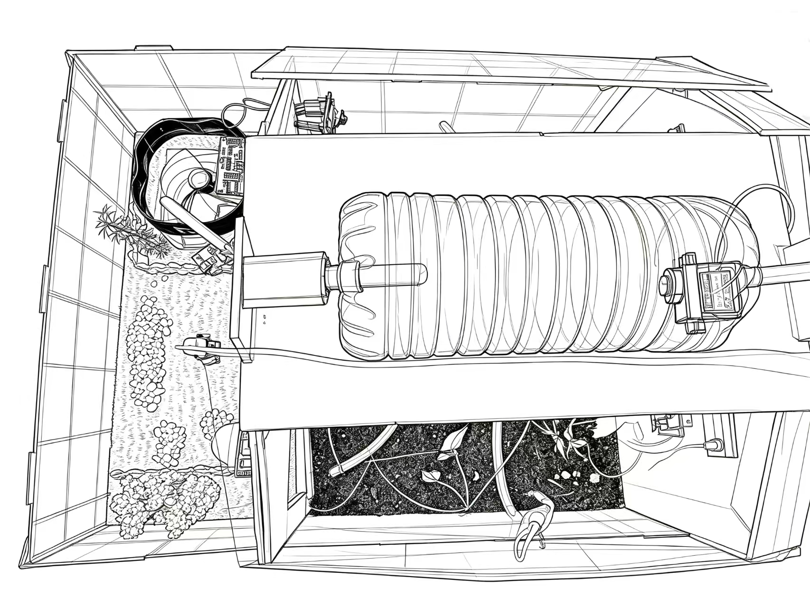
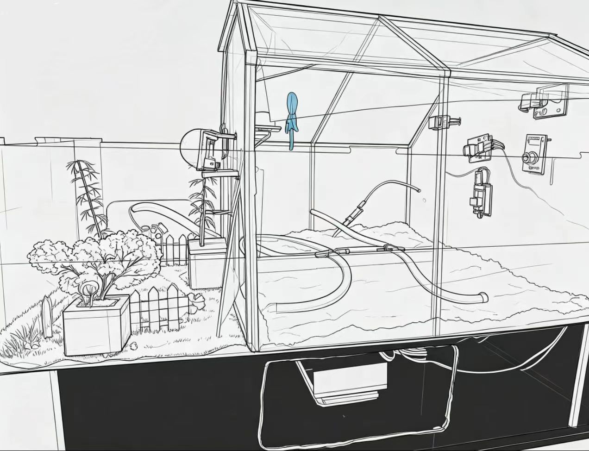

# 🌱 智慧温室大棚监测与控制系统

一个基于 **Flask + Vue 3 + Socket.IO + MySQL** 的智慧温室大棚物联网系统，实现传感器数据实时采集、设备远程控制、历史数据可视化、天气预报与 AI 智能决策。

前端采用深色科技风大屏布局，支持 3D 温室模型、城市切换、实时曲线、AI 对话助手与移动端适配。



---

## ✨ 功能特性

| 模块 | 说明 |
| --- | --- |
| 📡 实时监测 | 空气温湿度、土壤湿度、水位、CO₂、火焰、人体感应等数据秒级刷新 |
| 🔌 设备控制 | 风扇、水泵、舵机（通风口）、蜂鸣器、LED 指示灯，支持手动 / 自动模式 |
| 🎯 阈值设置 | 温度、湿度、土壤、CO₂、水位阈值在线配置，持久化到 MySQL 并下发到 Arduino |
| 📈 历史数据 | 历史曲线查询（Chart.js），支持不同时间范围与数据维度切换 |
| 🌤️ 天气智能体 | 基于 OpenWeatherMap 的预报 + 当前传感器状态，自动生成设备控制建议 |
| 🤖 AI 助手 | 接入阿里云百炼大模型（兼容 OpenAI 协议），结合实时传感器上下文对话 |
| 🔐 用户系统 | 注册、登录、找回密码，前端路由守卫鉴权 |
| 🗺️ 城市地图 | 内置中国城市数据，可切换城市查看对应天气 |
| 🧊 3D 可视化 | Three.js 加载温室 3D 模型，支持旋转、缩放查看 |
| ⚡ 实时通信 | Socket.IO 双向推送，附带 REST 轮询降级方案 |
| 📱 移动端适配 | 响应式布局，支持手机浏览器访问 |

---

## 🏗️ 系统架构

```text
┌──────────────────┐   USB 串口 9600   ┌───────────────────────────┐
│  Arduino 控制板   │ ────────────────▶ │  串口采集 / 4G 通信桥接     │
│  传感器 + 执行器  │ ◀──────────────── │  serial_to_db_fixed.py    │
└──────────────────┘   控制指令下发      │  zhiling.py (ADP-L610)    │
                                        └─────────────┬─────────────┘
                                                      │ MySQL / HTTP
                                                      ▼
                                        ┌───────────────────────────┐
                                        │      Flask 后端服务        │
                                        │  app_ultra_fast.py        │
                                        │  Socket.IO / REST API     │
                                        │  天气智能体 / AI 助手      │
                                        └─────────────┬─────────────┘
                                                      │ WebSocket / HTTP
                                                      ▼
                                        ┌───────────────────────────┐
                                        │      Vue 3 前端大屏        │
                                        │  Vite + Vue Router        │
                                        └───────────────────────────┘
```

系统支持两种数据接入方式：

1. **本地串口直连**：`serial_to_db_fixed.py` 直接读取 Arduino 串口并写入 MySQL，同时轮询命令队列文件下发控制指令。
2. **4G 远程通信**：`zhiling.py` 通过 ADP-L610 4G 模块，将传感器数据以 HTTP POST 发送到 `/api/adp610/data`，并轮询 `/api/device/commands` 获取控制指令。

---

## 🧰 技术栈

| 层次 | 技术 |
| --- | --- |
| 前端 | Vue 3、Vite 8、Vue Router 4、Socket.IO Client、Chart.js、Three.js |
| 后端 | Python、Flask 2.3、Flask-SocketIO、eventlet、Gunicorn |
| 数据库 | MySQL 8（`mysql-connector-python`） |
| 硬件通信 | pyserial、Arduino、ADP-L610 4G 模块 |
| 外部服务 | OpenWeatherMap API、阿里云百炼（DashScope） |

---

## 🔧 硬件清单

| 器件 | 引脚 | 用途 |
| --- | --- | --- |
| DHT11 | D13 | 空气温湿度 |
| 土壤湿度传感器 | A0 | 土壤含水率 |
| CO₂ / 空气质量传感器 | A3 | CO₂ 浓度（模拟量） |
| HC-SR04 超声波 | TRIG A1 / ECHO A2 | 水箱水位测距 |
| 火焰传感器 | D3 | 明火检测 |
| 人体红外传感器 | D7 | 人体感应 |
| 舵机 | D10 | 通风口开合（可按 CO₂ 自动控制） |
| 继电器 + 水泵 | D8 | 自动灌溉 |
| 风扇 | D5 | 降温 / 排湿 |
| 有源蜂鸣器 ×2 | D2 / D6 | 火焰、人体报警 |
| LED ×2 | D12 / D9 | 缺水红灯、CO₂ 黄灯 |
| OLED 显示屏 | A4 / A5（软件 I2C） | 本地数据展示 |
| ADP-L610 | 串口 | 可选，4G 远程通信 |

Arduino 完整示例代码见 [arduion.md](greenhouse_backed/arduion.md)，将其中的代码复制到 Arduino IDE 新建的 `.ino` 文件中即可编译烧录。

---

## 📁 目录结构

```text
greenhouse/
├── greenhouse_backed/              # 后端与设备通信
│   ├── app_ultra_fast.py           # Flask 主服务（REST API / Socket.IO / 后台线程）
│   ├── wsgi.py                     # Gunicorn 生产环境入口
│   ├── weather_agent.py            # 天气感知与智能决策智能体
│   ├── serial_to_db_fixed.py       # 串口采集 → MySQL + 命令下发
│   ├── zhiling.py                  # ADP-L610 4G 双向 HTTP 通信
│   ├── serial_watchdog.py          # 串口进程守护
│   ├── arduion.md                  # Arduino 示例固件
│   ├── smart-home.conf             # Nginx 部署配置示例
│   ├── requirements.txt            # Python 依赖
│   ├── .env.example                # 环境变量模板
│   └── image/                      # 后端静态图片
├── greenhouse_fronted/             # 前端工程
│   ├── src/
│   │   ├── views/                  # 登录、总览、控制、历史页面
│   │   ├── components/             # 中国地图组件
│   │   ├── stores/                 # 共享城市状态
│   │   ├── utils/socket.js         # Socket.IO 客户端
│   │   ├── router/index.js         # 路由与登录守卫
│   │   └── data/china_cities.js    # 城市数据
│   ├── public/                     # 3D 模型、图片等静态资源
│   ├── vite.config.js              # 开发代理配置
│   └── package.json
└── README.md
```

---

## 🚀 快速开始

### 1. 环境要求

- Python 3.9+
- Node.js 18+
- MySQL 8.0+
- Arduino IDE（硬件调试时需要）

### 2. 克隆仓库

```bash
git clone https://github.com/xinkong-kew/greenhouse.git
cd greenhouse
```

### 3. 初始化数据库

```sql
CREATE DATABASE sensor_db DEFAULT CHARACTER SET utf8mb4;
```

`users`、`threshold_config` 表会在后端启动时自动创建；`sensor_data` 表由串口采集脚本首次运行时自动创建。

### 4. 配置环境变量

参考 `.env.example` 设置环境变量。项目启动时读取的是**进程环境变量**，不会自动加载 `.env` 文件，可按需通过命令行、systemd 或容器注入：

```bash
# Linux / macOS（加载 .env 后启动）
set -a && source .env && set +a

# Windows PowerShell
$env:DB_PASSWORD="your-password"
$env:DASHSCOPE_API_KEY="sk-xxxx"
```

| 变量 | 说明 |
| --- | --- |
| `DB_HOST` / `DB_PORT` / `DB_USER` / `DB_PASSWORD` / `DB_NAME` | MySQL 连接信息 |
| `DASHSCOPE_API_KEY` | 阿里云百炼 API Key（AI 助手） |
| `DASHSCOPE_BASE_URL` / `DASHSCOPE_MODEL` | 大模型接口地址与模型名 |
| `SERVER_PORT` | 后端服务端口，默认 `5000` |
| `SECRET_KEY` | Flask 会话密钥 |
| `SERIAL_PORT` | 可选，手动指定 Arduino 串口（如 `COM3` / `/dev/ttyUSB0`） |

> ⚠️ 请勿将真实的 `.env`、API Key、数据库密码提交到仓库。

### 5. 启动后端

```bash
cd greenhouse_backed
python -m venv .venv
.venv\Scripts\activate          # Windows
source .venv/bin/activate       # Linux / macOS
pip install -r requirements.txt
python app_ultra_fast.py
```

启动后访问 <http://localhost:5000> 即可看到页面（需先构建前端，或使用前端开发服务器）。

### 6. 启动前端

```bash
cd greenhouse_fronted
npm install
npm run dev
```

开发服务器默认运行在 <http://localhost:5173>，已配置 `/api` 与 `/socket.io` 代理到 `localhost:5000`。

构建生产文件：

```bash
npm run build
```

构建产物输出到 `greenhouse_fronted/dist`，后端会直接托管该目录。

### 7. 启动串口采集（可选，无硬件时跳过）

```bash
cd greenhouse_backed
python serial_to_db_fixed.py     # 本机串口直连模式
# 或
python zhiling.py                # ADP-L610 4G 远程通信模式
```

> `zhiling.py` 中的 `SERIAL_PORT_ADP = 'COM23'`、`SERIAL_PORT_CTRL = 'COM28'` 需按实际设备修改。

---

## 🖥️ 生产部署

```bash
cd greenhouse_backed
gunicorn -k eventlet -w 1 -b 0.0.0.0:5000 wsgi:app
```

Nginx 反向代理与 HTTPS 配置参考 [smart-home.conf](greenhouse_backed/smart-home.conf)，其中已包含 `/api/`、`/socket.io/` 的代理与 SPA 路由回退配置。

---

## 📡 主要 API

| 方法 | 路径 | 说明 |
| --- | --- | --- |
| GET | `/api/recent_data` | 最新实时数据 |
| GET | `/api/history` | 历史数据查询（支持时间范围） |
| GET | `/api/device/status` | 设备运行状态 |
| POST | `/api/device/control` | 设备控制（开 / 关 / 自动） |
| POST | `/api/threshold/set` | 设置阈值 |
| POST | `/api/threshold/query` | 查询阈值 |
| GET | `/api/weather` | 当前天气与预报 |
| POST | `/api/weather/set_city` | 切换城市 |
| POST | `/api/ai/chat` | AI 助手对话 |
| GET | `/api/agent/decisions` | 智能体决策记录 |
| POST | `/api/adp610/data` | 4G 模块上报传感器数据 |
| GET | `/api/device/commands` | 设备轮询待执行指令 |
| POST | `/api/auth/register` `/api/auth/login` | 用户注册 / 登录 |
| GET | `/api/health` | 健康检查 |

Socket.IO 事件：`request_data`、`request_device_status`、`request_chart_data`、`request_weather`、`set_city`，服务端推送 `sensor_update`、`device_status_update`、`chart_update`、`weather_update`。

---

## 🔌 Arduino 串口指令

设备通过 9600 波特率串口接收换行结尾的文本指令：

| 功能 | 指令 |
| --- | --- |
| 风扇 | `FAN_ON` / `FAN_OFF` / `FAN_AUTO` |
| 水泵 | `1`（开）/ `0`（关）/ `auto`（自动） |
| 温度阈值 | `GET_TEMP` / `SET_TEMP 30` |
| CO₂ 阈值 | `GET_CO2` / `SET_CO2 700` |
| 土壤阈值 | `GET_SOIL` / `SET_SOIL 60` |
| 空气湿度阈值 | `GET_HUMI` / `SET_HUMI 80` |
| 水位阈值 | `GET_WATER` / `SET_WATER 20` |
| 舵机 | `SERVO_AUTO` / `SERVO_0` / `SERVO_90` / `SERVO_180` / `SERVO_45` |
| 火焰蜂鸣 | `FLAME_ON` / `FLAME_OFF` / `FLAME_AUTO` |
| 人体蜂鸣 | `HUMAN_ON` / `HUMAN_OFF` / `HUMAN_AUTO` |

Arduino 每轮上报一行传感器数据与一行阈值汇总，格式示例：

```text
[#123] 土壤=45% CO2=420 人体=0 火焰=1 水位=62.5% 距离=12.3cm 温度=26.50℃ 湿度=60.20%
阈值汇总: 温度=30.0C 湿度=80.0% 土壤=60% CO2=700 水位=20% 风扇=自动 水泵=自动 ...
```

---

## 🎨 界面预览

| 作品线稿 | 温室俯视图 |
| --- | --- |
|  |  |

---

## ❓ 常见问题

**1. 启动后页面空白或 404**
先执行 `npm run build` 生成 `greenhouse_fronted/dist`，后端直接托管该目录；开发时请访问 Vite 的 5173 端口。

**2. 提示数据库连接失败**
确认 MySQL 已启动、`sensor_db` 已创建，且 `.env` 中的账号密码正确。

**3. 串口找不到设备**
Windows 可在设备管理器查看 COM 号；Linux 一般为 `/dev/ttyUSB0`，也可通过环境变量 `SERIAL_PORT` 指定。Linux 下需将用户加入 `dialout` 组。

**4. AI 助手不可用**
检查 `DASHSCOPE_API_KEY` 是否有效、网络是否可访问阿里云百炼，可访问 `/api/ai/status` 查看状态。

**5. 天气数据不更新**
`weather_agent.py` 中的 OpenWeatherMap API Key 需替换为自己的免费 Key，并确保服务器可访问外网。

**6. Socket.IO 连接失败**
生产环境需在 Nginx 中正确代理 `/socket.io/` 并支持 WebSocket Upgrade（参考 `smart-home.conf`）。

---

## 📄 说明

本项目为学习与实践项目，涉及硬件、后端、前端、数据库与 AI 服务的完整链路。使用前请自行替换所有密钥与密码，并遵守相关服务的使用条款。
